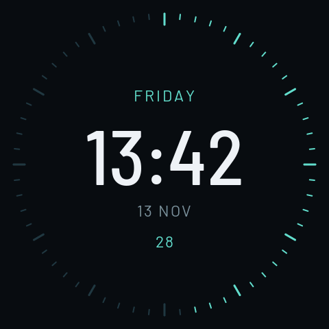

# ESP32 Round Display Lab

面向 **Waveshare ESP32-S3-Touch-LCD-2.1** 圆形触摸屏开发板的实验仓库。
这里用于尝试时钟、传感器交互、图形界面及其他板载应用，每个实验独立存放，构建与烧录工具共用。

当前硬件：ESP32-S3、16 MB Flash、8 MB OPI PSRAM、480×480 圆形屏、QMI8658 六轴 IMU、PCF85063 RTC。

## 示例

| 示例 | 功能 | 状态 |
| --- | --- | --- |
| [Gravity Clock](examples/gravity-clock) | 根据重力自动保持正立的数字时钟，含日期、秒刻度与 USB 校时 | 已完成实机方向与 RTC 重启验证；Barlow 字体公开版已刷入并检查运行状态和显示缓冲区 |



预览由与固件相同的绘图代码生成。公开版使用 Barlow 开源字体。

## 目录

```text
boards/       板卡参数、引脚与驱动来源
examples/     独立实验，每个实验有 example.json 和 Arduino sketch
scripts/      环境安装、构建、烧录、字体生成及测试
assets/       可再分发字体及许可证
docs/         开发说明和示例预览
```

`build/`、`.cache/`、`.tools/`、`.venv/` 和固件备份均保留在本地，不进入版本控制。

## 快速开始

支持 macOS / Linux，需 Python 3.11+、Git、curl、C/C++ 编译器与 make。Apple Silicon 已处理 Arduino 的 Intel-only 工具兼容问题。

```sh
git clone https://github.com/andrewdiyi/esp32-round-display-lab.git
cd esp32-round-display-lab
sh scripts/setup.sh
.venv/bin/python scripts/build.py gravity-clock
```

构建时会下载并校验微雪官方演示包，生成本地显示驱动文件。下载或编译不会操作连接的设备。固件输出到 `build/gravity-clock/firmware/`。

### 备份与烧录

第一次改写板卡前，建议先备份现有固件。将以下串口路径替换为本机实际设备：

```sh
.venv/bin/python -m serial.tools.list_ports -v
mkdir -p backups
.venv/bin/esptool --chip esp32s3 --port /dev/cu.usbmodemXXXX read-flash 0 ALL backups/original.bin
.venv/bin/python scripts/flash.py gravity-clock --port /dev/cu.usbmodemXXXX
.venv/bin/python examples/gravity-clock/clock_control.py --sync
```

烧录脚本要求明确指定串口，会核对 USB VID/PID；可加 `--expected-serial` 进一步限定目标。仅凭 USB ID 不能区分不同型号的 ESP32 开发板，请确认连接的是上述板卡。时钟的烧录配置沿用原厂分区布局，写入 bootloader、分区表、OTA 初始化数据与 app0。

## 开发与验证

```sh
sh scripts/test.sh
.venv/bin/ruff check scripts examples/gravity-clock/clock_control.py
.venv/bin/ruff format --check scripts examples/gravity-clock/clock_control.py
.venv/bin/python scripts/generate_fonts.py
```

原生测试覆盖姿态角、跨 ±180°、平放保持、异常加速度和像素旋转，并生成 `build/tests/preview.png`。GitHub Actions 执行这些检查和 ESP32 固件编译。

新增实验时，在 `examples/<name>/` 中放置 sketch 与 `example.json`，引用 `boards/` 下的板卡配置，再执行 `.venv/bin/python scripts/build.py <name>`。目前板卡驱动准备流程针对 ST7701 圆屏；换板时应增加相应配置与驱动处理。

## 资料

- [板卡引脚与构建参数](boards/waveshare-esp32-s3-touch-lcd-2.1/README.md)
- [时钟使用、串口协议及验证范围](examples/gravity-clock/README.md)
- [第三方来源与许可范围](THIRD_PARTY.md)

仓库尚未为自编代码指定统一开源许可证；公开可见不代表所有内容采用同一许可。字体附带 SIL OFL 1.1，微雪驱动从原站获取，详见来源说明。
