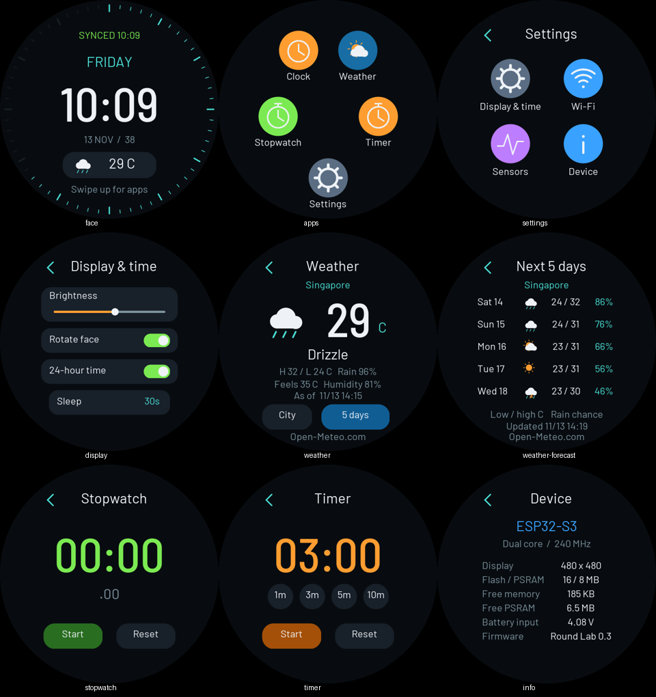
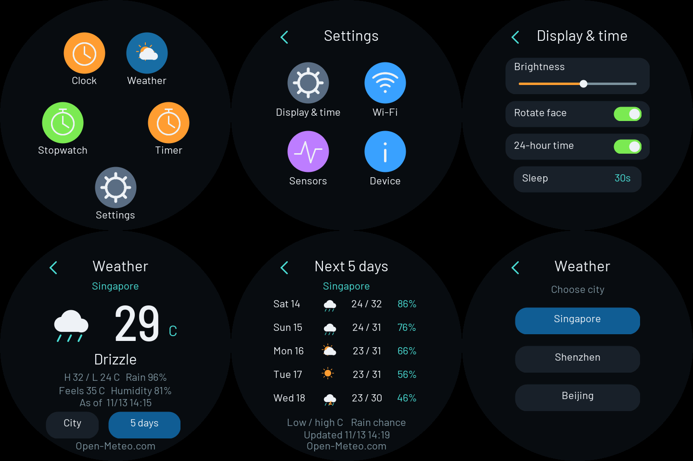
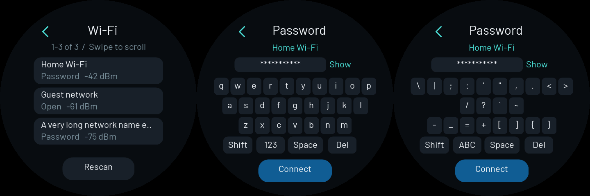

# Watch Shell

480×480 圆屏上的英文手表界面：重力表盘、应用网格、快捷设置、天气、秒表、倒计时，以及设置内的运动传感器、硬件信息和 Wi-Fi 配网。它使用板载 CST820 触摸与 QMI8658 IMU，延续 Gravity Clock 的 Barlow 字体、覆盖率抗锯齿和双线性旋转。



预览来自与固件相同的绘图代码，数值是演示数据。

## 操作

| 位置 / 手势 | 功能 |
| --- | --- |
| 表盘上滑 / 点击时间 | 打开应用网格 |
| 表盘下滑 | 快捷设置：Wi-Fi、表盘旋转、亮度、熄屏 |
| 表盘左滑 | 天气 |
| 点击表盘顶部校时状态 | 联网重新校时；离线时打开 Wi-Fi |
| 点击表盘下方天气卡片 | 打开当前天气 |
| 应用内右滑 / 左上角返回 | 返回上一级；Sensors / Wi-Fi / Device 返回 Settings |
| 应用网格下滑或右滑 | 返回表盘 |
| 长按约 0.7 秒 | 返回表盘 |
| 熄屏后触摸 | 唤醒，首次触摸不执行按钮动作 |

表盘随重力连续旋转；离开表盘时，应用界面固定到最近的 90° 方向，触摸坐标对应显示方向。回到表盘再进入应用可重新确定菜单方向。

## 应用与设置

- **Clock**：时间、日期、星期、秒刻度，以及当前温度和天气图标。点击下方天气卡片打开 Weather；数据尚未获取时显示占位，离线或更新失败时标注 Cached weather。时区为 UTC+8；RTC 存 UTC。每次连接 Wi-Fi 后发起 NTP 校时，在线时每小时同步，成功后写入 RTC。表盘顶部显示 `SYNCING TIME` / `SYNCED HH:MM` / `RTC / OFFLINE`；点击该区域可重新校时。
- **Stopwatch**：开始、暂停、继续、复位。切换页面或熄屏后继续计时。
- **Timer**：1 / 3 / 5 / 10 分钟预设，暂停、继续、复位。到时打开计时器页面并短鸣提醒。
- **Settings → Sensors**：加速度、角速度和倾斜指示。数值是板卡坐标系。
- **Settings → Device**：CPU、屏幕、Flash / PSRAM、可用内存、ADC 电压、固件版本。没有电池时，Battery input 不能作为电量判断。
- **Settings → Display & time**：亮度滑条、表盘自动旋转、12 / 24 小时格式、15 / 30 / 60 秒或不自动熄屏。设置保存到 NVS。
- **Settings → Wi-Fi**：在圆屏上扫描网络、输入密码并连接；连接互联网后自动 NTP 校时并更新 RTC。

熄屏只关闭背光并暂停绘图，不是 ESP32 深度睡眠。计时器和秒表不跨断电保存。

## 天气

主应用网格只保留 **Clock / Weather / Stopwatch / Timer / Settings**。Sensors、Wi-Fi、Device 位于 Settings 中。

**Weather** 默认新加坡，显示当前温度、天气状况、体感温度、湿度、今日高低温与降雨概率。点击 **5 days** 或上滑查看未来五天的天气图标、每日高低温和降雨概率；右滑返回当前天气。**City** 可选择 Singapore / Shenzhen / Beijing，选择会保存到设备。



预览中的数值为演示数据。设备在线时每 30 分钟更新一次；下滑或点击底部 `Open-Meteo.com` 可立即刷新。HTTPS 请求在独立任务中运行，等待网络时仍能操作触摸和其他应用。断网或更新失败时保留本次开机已获取的数据，并显示离线 / 更新失败状态及数据时间；重启后重新获取。

天气数据来自 [Open-Meteo](https://open-meteo.com/)，按 [CC BY 4.0](https://creativecommons.org/licenses/by/4.0/) 使用。当前条件来自天气模型，界面标注 `As of` 数据时间；[免费 API](https://open-meteo.com/en/terms) 用于非商业个人实验，无需 API key。使用系统 CA 证书验证 HTTPS，JSON 使用 Arduino-ESP32 自带 cJSON 解析，没有新增第三方库。

## 在圆屏上连接 Wi-Fi

1. 打开 **Settings → Wi-Fi**。未连接时自动扫描附近的 **2.4 GHz** 网络；已连接时点 **Scan networks**。
2. 网络按信号强度排序，每页三项，上下滑动翻页；点 **Rescan** 重新扫描。
3. 点击自己的网络，在屏幕键盘输入密码，然后点 **Connect**。开放网络无需输入密码。
4. 显示 **Connected** 和 IP 地址后即可使用，凭据会保存到设备，之后开机自动连接。



图中使用演示网络与密码。整个流程在圆屏上完成，无需手机、电脑或配网热点。

键盘支持全部可打印 ASCII 字符：**Shift** 切换大小写，**123 → #+= → ABC** 切换数字、符号和字母，**Space** 输入空格，**Del** 删除末尾字符。密码为 8–63 字符，默认隐藏；点 **Show / Hide** 切换显示，输入框显示末尾内容。输入密码期间不会自动熄屏。连接失败后返回 **Try again** 页面，可修改密码重试；未成功连接的密码不会覆盖已保存网络。

左上角或右滑返回上一级：密码 → 网络列表 → Wi-Fi 状态 → Settings。Wi-Fi 状态页可以关闭无线网络。

支持可扫描到的开放网络和 WPA/WPA2/WPA3 Personal 网络；不提供隐藏网络名称输入、企业认证或网页登录。当前英文字体将 SSID 中的非 ASCII 字符显示为 `?`，连接仍使用完整原始 SSID。密码只保存在设备 NVS，不写入源码或串口状态。未联网也能使用 RTC 或 USB 校时。

## 构建与烧录

在仓库根目录执行（环境安装见根 README）：

```sh
.venv/bin/python scripts/build.py watch-shell
.venv/bin/python scripts/flash.py watch-shell --port /dev/cu.usbmodemXXXX
.venv/bin/python examples/watch-shell/watch_control.py --sync --page face
```

与 Gravity Clock 是独立固件；烧录其中一个即运行对应示例。显示驱动由构建工具从官方演示包生成，详见板卡说明。

## 调试和预览

```sh
# 请求联网校时（--sync 则使用电脑的时间通过 USB 校时）
.venv/bin/python examples/watch-shell/watch_control.py --ntp

# 状态与实际 framebuffer 截图
.venv/bin/python examples/watch-shell/watch_control.py
.venv/bin/python examples/watch-shell/watch_control.py --page apps --capture build/watch-shell/apps.png

# 在电脑上生成页面、天气和 Wi-Fi 键盘预览，不连接设备
mkdir -p build/watch-shell/preview
c++ -std=c++17 -O2 examples/watch-shell/preview.cpp -o build/watch-shell/preview-ui
build/watch-shell/preview-ui build/watch-shell/preview

# 修改字体尺寸后重新生成字体数据
.venv/bin/python scripts/generate_watch_fonts.py
```

串口每行一条命令：`STATUS`、`TIME <UTC epoch>`、`NTP`、`RECONNECT`、`WAKE`、`PAGE <name>`、`CAPTURE`。页面名为 `face / apps / controls / settings / stopwatch / timer / sensors / info / wifi / weather / display`。截图协议与 Gravity Clock 相同，返回 RGB565 小端像素。`STATUS` 包含 `scanning`、`network_count`、`connecting` 和 `ntp_synced_at`（最后一次 NTP 同步的 UTC epoch，尚未同步时为 0），另含天气请求状态和数据时间，不包含网络密码。

`Weather.h` 定义天气数据和城市，`WeatherClient.h` 负责 HTTPS 请求及响应解析。`WatchUi.h` 负责绘制和页面状态，`WatchShell.ino` 负责设备、触摸、应用逻辑、网络与持久化。添加内置应用直接增加页面和对应绘制、点击逻辑即可；当前没有动态安装应用、手机通知同步或后台应用管理。

显示像素时钟使用 8 MHz，为 Wi-Fi 和绘图留出内存带宽。此 Arduino 构建写 Flash 时会暂停 PSRAM 访问，因此保存设置、配网凭据和初始化 Wi-Fi 后显式重新同步 RGB DMA，处理实机遇到的画面整体偏移；详见[乐鑫 RGB 屏幕漂移说明](https://docs.espressif.com/projects/esp-faq/en/latest/software-framework/peripherals/lcd.html#why-do-i-get-drift-overall-drift-of-the-display-when-esp32-s3-is-driving-an-rgb-lcd-screen)。CST820 选择寄存器后发送 STOP，再读取数据，与原厂触摸驱动一致。

## 验证范围

2026-11-13：固件编译、烧录校验、RTC 读时与 USB 校时成功；九个页面通过同源绘图预览检查，表盘通过设备 framebuffer 截图检查。修复显示偏移后，实机操作确认画面居中、应用点击和滑动正常，并打开 Wi-Fi 配网入口。串口状态确认触摸和 IMU 应答。

尚未完成倒计时到时蜂鸣及长时间运行验证。电脑预览与 framebuffer 截图无法验证物理屏幕的扫描偏移，因此显示稳定性也依赖上述实机观察。

0.2 版移除网页配网，加入设备端扫描和密码键盘。已编译、刷入并校验，实机扫描到 5 个网络并检查了列表 framebuffer；字母和符号键盘通过同源绘图预览检查。用户已在圆屏上输入真实网络密码并确认显示 Connected；串口确认 `wifi_connected=true`、`connecting=false`、`clock_valid=true`，且 `ntp_synced_at` 已记录成功的 NTP 同步时间。该次检查触摸和 IMU 错误计数均为 0。

0.3 版加入 Weather、表盘校时状态和手动 NTP 入口，并将 Sensors / Wi-Fi / Device 移入 Settings。已完成固件编译、刷写校验、最终固件重启后的保存网络自动连接、自动 NTP 校时、HTTPS 真实天气获取；手动 NTP 请求后同步时间戳更新且 `time_syncing=false`。新加坡当前天气通过设备 framebuffer 检查，未来五天数据通过响应解析，页面排版通过同源预览检查。用户进一步实机确认：点击 5 days 查看预报、进入 Settings 中的 Sensors / Wi-Fi / Device，以及页面显示、点击和返回均正常。
